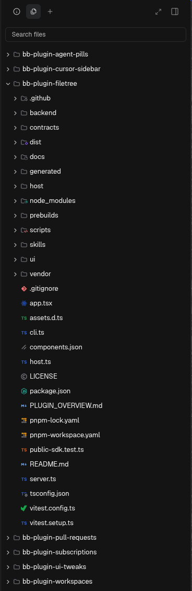

# FileTree

A Codex-style file tree for BB.



- Browse workspaces and project sources with search, Git status and live updates.
- Pick a file to open it in BB's own viewer, in the thread's main pane.
- Stays pinned in every thread's right panel on BB builds with a main pane
  (`wy3z/bb` `feat/main-pane-tabs`). Elsewhere, choose **+ → Files**.

File access is read-only.

```sh
bb plugin install https://github.com/wy3z/bb-plugin-filetree
```

Requires BB 0.42+. Includes a Linux x64 build; macOS requires a native build. Windows is unsupported.

[Development and CLI](docs/development.md)
